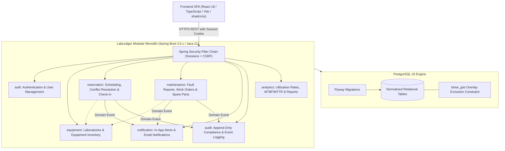

# LabLedger: University Laboratory Equipment Reservation & Lifecycle Maintenance Platform

[](https://github.com/Rohan23Nova/Lab-Equipment-Maintenance-Platform)
[](https://adoptium.net/)
[](https://spring.io/projects/spring-boot)
[](https://www.postgresql.org/)
[](https://react.dev/)
[](https://tailwindcss.com/)

**LabLedger** is a production-minded academic laboratory equipment reservation, scheduling, and lifecycle maintenance platform. Built as an Advanced Java course project, it addresses operational challenges in university research facilities: fragmented reservation spreadsheets, schedule double-bookings, unmonitored instrument wear-and-tear, uncoordinated maintenance downtime, and audit compliance deficiencies.

---

## 1. Product Capabilities & User Personas

| Persona | Core Capabilities |
|---|---|
| **Students & Researchers (`ROLE_STUDENT`)** | Browse lab catalog, inspect instrument specifications, book equipment time slots, complete check-in/out during usage, view qualification certifications, submit fault reports. |
| **Faculty & PIs (`ROLE_FACULTY`)** | Sponsoring student research bookings, reserving specialized laboratory bays, tracking project equipment usage, and reviewing departmental equipment utilization. |
| **Lab Managers (`ROLE_LAB_MANAGER`)** | Managing equipment inventory, reviewing and approving restricted equipment bookings, triaging user fault reports, assigning maintenance work orders to technicians, logging replacement spare parts, and tracking instrument downtime. |
| **System Administrators (`ROLE_ADMIN`)** | Platform-wide user management, role assignments, laboratory facility setup, system configuration, and compliance audit log inspection. |

---

## 2. Technology Stack & Pinned Specifications

### Backend
- **Language**: Java 21 LTS (Amazon Corretto / Eclipse Temurin)
- **Framework**: Spring Boot 3.5.x
- **Build Tool**: Apache Maven 3.9+ with Maven Wrapper (`mvnw`)
- **Persistence**: Spring Data JPA & Hibernate 6.x
- **Database Migrations**: Flyway (`flyway-core`, `flyway-database-postgresql`)
- **Security**: Spring Security 6.x
  - Stateful server-side sessions with `JSESSIONID` (`HttpOnly`, `Secure`, `SameSite=Strict`)
  - Cross-Site Request Forgery (CSRF) protection with `X-XSRF-TOKEN` header validation
  - Method-level security (`@PreAuthorize`) and Role-Based Access Control (RBAC)
- **Validation**: Jakarta Bean Validation (`spring-boot-starter-validation`)
- **API Documentation**: OpenAPI 3 / Swagger UI (`springdoc-openapi-starter-webmvc-ui`)
- **Testing**: JUnit 5, AssertJ, Mockito, Spring MVC Test (`@WebMvcTest`), and Testcontainers PostgreSQL 16

### Frontend
- **Framework**: React 18 (TypeScript)
- **Build Tool / Bundler**: Vite 6.x
- **Styling**: Tailwind CSS 3.4.x
- **UI Primitives**: shadcn/ui (Radix UI accessible primitives)
- **Icons**: Lucide React
- **Server State & Caching**: TanStack Query (React Query) v5
- **HTTP Client**: Axios with credentials and automatic CSRF interceptors
- **Testing**: Vitest, React Testing Library, jsdom, Mock Service Worker (MSW)

### Infrastructure & Persistence
- **Database**: PostgreSQL 16 Alpine
- **Database Extensions**: `uuid-ossp`, `btree_gist` (for GiST temporal range exclusion constraints)
- **Local Dev Orchestration**: Docker Compose v2
- **Continuous Integration**: GitHub Actions

---

## 3. Architecture & Modular Boundaries

LabLedger is architected as a **modular monolith** with clean boundary encapsulation, strong transactional consistency, and zero cross-module database joins:



### Architectural Highlights
- **Strict Layering**: Controller -> Service -> Repository -> Entity. Controllers never execute domain logic.
- **Immutable DTO Boundaries**: All external API contracts use **Java 21 `record`s**. JPA entities are never exposed in API responses.
- **Half-Open Intervals**: All reservation intervals are modeled as $[start, end)$. Adjacent bookings $[10:00, 11:00)$ and $[11:00, 12:00)$ do not collide.
- **Double-Booking Defense**: Pessimistic locking at service layer combined with PostgreSQL `btree_gist` exclusion constraints at the storage engine level.
- **Timezone Discipline**: All timestamps stored strictly in UTC (`TIMESTAMPTZ` / `java.time.Instant`) and formatted to the user's local timezone in the React UI.
- **Monetary Integrity**: Financial figures (repair costs, spare parts, equipment value) use `NUMERIC(12, 2)` and Java `BigDecimal`.

---

## 4. Repository Structure

```
.
├── .editorconfig                # Global code formatting standards
├── .env.example                 # Environment variable template (safe defaults)
├── .gitignore                   # Multi-language Git ignore rules
├── AGENTS.md                    # Persistent instructions and invariants for AI agents
├── README.md                    # Project overview and technical handbook
├── docs/                        # Architectural blueprints and engineering guides
│   ├── ARCHITECTURE.md          # Modular monolith design, packages, concurrency
│   ├── DATA_MODEL.md            # ER diagram, schema specs, Flyway roadmap
│   ├── DECISIONS.md             # Architecture Decision Records (ADR-001 - ADR-007)
│   ├── IMPLEMENTATION_PLAN.md   # Phased delivery roadmap (Phase 00 - Phase 06)
│   ├── SECURITY.md              # Session security, CSRF, RBAC matrix, password policy
│   └── TESTING_STRATEGY.md      # Testing pyramid, Testcontainers, Vitest, quality gates
├── pom.xml                      # Root Maven build descriptor (Phase 01)
├── docker-compose.yml           # Local PostgreSQL infrastructure (Phase 01)
├── src/                         # Spring Boot backend source code (Phase 01+)
└── frontend/                    # React / Vite single-page application (Phase 01+)
```

---

## 5. Implementation Roadmap

- [x] **Phase 00: Project Foundation** — Architecture blueprints, data model specifications, security model, testing strategy, ADRs, code formatting, and Git baseline.
- [ ] **Phase 01: Core Scaffolding, Build & CI Setup** — Maven build setup, Docker Compose for PostgreSQL, React/Vite scaffolding, base error handling (RFC 7807), and GitHub Actions workflow.
- [ ] **Phase 02: Authentication & User Management** — User entities, BCrypt hashing, server-side session cookies, CSRF handshake, RBAC guards, and user profile management.
- [ ] **Phase 03: Equipment Inventory Module** — Laboratories, equipment categories, physical assets, status lifecycle (`AVAILABLE`, `IN_USE`, `UNDER_MAINTENANCE`), search, and filters.
- [ ] **Phase 04: Reservations & Scheduling Engine** — Calendar scheduler, half-open interval validation, GiST exclusion constraints, approval workflows, and check-in/out.
- [ ] **Phase 05: Fault Reports, Maintenance & Notifications** — Fault reporting, triage, work orders, spare parts consumption, asynchronous event notifications.
- [ ] **Phase 06: Audit History, Analytics & Hardening** — Append-only audit logging, utilization analytics, MTBF/MTTR metrics, CSV export, and end-to-end integration tests.

---

## 6. Engineering Standards

- **Constructor Injection**: All Spring components use constructor injection (via `@RequiredArgsConstructor` or explicit constructors). Field injection (`@Autowired` on fields) is forbidden.
- **Fail Fast with Structured Errors**: Validation errors and business rule failures return RFC 7807 `ProblemDetail` with field-level breakdowns.
- **Zero Secrets in Repository**: No passwords, tokens, or credentials may ever be committed. All configuration is externalized via `.env`.
- **Database Migrations First**: Database schema changes are performed strictly via Flyway migration scripts. Hibernate `ddl-auto` is set to `validate`.

---

## 7. Documentation Index

For detailed specifications, consult the documents in the [`docs/`](docs/) directory:
- [Architecture Blueprint](docs/ARCHITECTURE.md)
- [Data Model & Schema](docs/DATA_MODEL.md)
- [Security & Access Control](docs/SECURITY.md)
- [Testing Strategy](docs/TESTING_STRATEGY.md)
- [Architecture Decision Records](docs/DECISIONS.md)
- [Implementation Plan](docs/IMPLEMENTATION_PLAN.md)
- [Agent Operational Guidelines](AGENTS.md)
