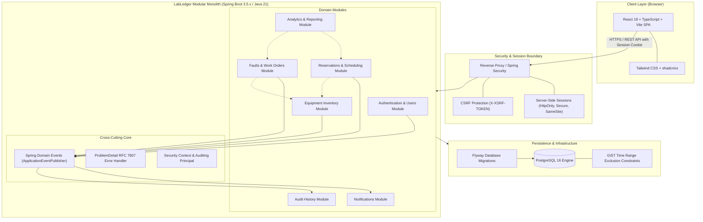

# LabLedger System Architecture

## 1. Executive Summary

**LabLedger** is an enterprise-grade laboratory equipment reservation and lifecycle maintenance platform designed for university environments. Academic research institutions struggle with fragmented spreadsheets, double-booked specialized equipment, uncoordinated maintenance downtime, and lack of compliance audit trails. LabLedger provides a centralized, dependable solution covering:
- Equipment discovery and catalog management across university departments.
- Scheduling and conflict-free reservations for students, researchers, and faculty.
- Operator certification enforcement prior to high-risk instrument usage.
- Fault reporting, maintenance work order dispatch, and spare parts tracking.
- Transparent audit history, downtime analytics, and Mean Time Between Failures (MTBF) tracking.

LabLedger is engineered as a **modular monolith** with clean architectural boundaries, strong type safety, database-level concurrency protection, and decoupled presentation.

---

## 2. Architectural Paradigm: Modular Monolith

### 2.1 Why a Modular Monolith?
Microservices introduce operational overhead (distributed transactions, network latency, complex observability, service discovery) that creates unnecessary friction for a unified university domain. Conversely, an unstructured monolith degenerates into an unmaintainable "big ball of mud."

LabLedger adopts a **modular monolith** architecture:
1. **Single Deployment Unit**: One Spring Boot application running on Java 21, simplifying deployment, transactions, and continuous delivery.
2. **Strict Module Boundaries**: High internal cohesion and low coupling. Domain boundaries are enforced through dedicated package structures and explicit public interfaces.
3. **Transactional Integrity**: Critical cross-entity operations (e.g., equipment reservation with conflict check and audit log) leverage local ACID database transactions without requiring two-phase commits.
4. **Future Extensibility**: Well-defined domain modules can be extracted into independent microservices if organizational scale demands it in the future.



---

## 3. Domain Modules & Boundaries

| Module | Core Responsibility | Key Invariants | Exposed Events |
|---|---|---|---|
| **Authentication & Users (`auth`)** | User accounts, authentication, role assignment (`STUDENT`, `FACULTY`, `LAB_MANAGER`, `ADMIN`), user certifications. | Passwords hashed with BCrypt. Server-side sessions only. Certifications must be validated before operating restricted equipment. | `UserRegisteredEvent`, `UserDeactivatedEvent` |
| **Equipment Inventory (`equipment`)** | Laboratories, equipment categories, physical items, serial numbers, operational statuses (`AVAILABLE`, `IN_USE`, `UNDER_MAINTENANCE`, `DECOMMISSIONED`), manuals. | Each equipment item belongs to a physical lab. Items under maintenance or decommissioned cannot be reserved. | `EquipmentCreatedEvent`, `EquipmentStatusChangedEvent` |
| **Reservations & Scheduling (`reservation`)** | Booking creation, approval workflows, schedule conflict resolution, check-in and check-out lifecycle. | Booking intervals are half-open `[start, end)`. No overlapping active reservations on the same equipment. Operators must possess required certification. | `ReservationCreatedEvent`, `ReservationConfirmedEvent`, `ReservationCancelledEvent`, `ReservationCompletedEvent` |
| **Fault Reports & Work Orders (`maintenance`)** | User-submitted fault tickets, manager triage, work orders, technician assignment, spare parts used, maintenance logs. | When a critical fault or work order begins, equipment status immediately transitions to `UNDER_MAINTENANCE`. | `FaultReportedEvent`, `WorkOrderCreatedEvent`, `WorkOrderCompletedEvent` |
| **Notifications (`notification`)** | In-app notification center, asynchronous email alerts via SMTP/templates. | Notifications must never block core business transactions (executed asynchronously via event listeners). | `NotificationDispatchedEvent` |
| **Audit History (`audit`)** | Immutable log of all administrative, reservation, inventory, and security actions. | Append-only. Audit logs cannot be modified or deleted via API. Captures actor, timestamp (UTC), IP, and state diff. | N/A (Consumes domain events) |
| **Analytics & Reporting (`analytics`)** | Equipment utilization rates, peak hours, MTBF, MTTR, maintenance costs, and CSV/JSON export. | Read-only reporting queries. Calculations use `BigDecimal` for financial costs and UTC durations for metrics. | N/A |

### 3.1 Inter-Module Communication Rules
1. **No Cross-Module Database Joins across Repositories**: Modules must query their own tables. When cross-module data is needed, queries must be coordinated through explicit Service interfaces or aggregate views.
2. **Asynchronous Event-Driven Decoupling**: Side effects (notifications, audit logging, search indexing) must listen to `ApplicationEvent`s published via Spring's `ApplicationEventPublisher`. The triggering module must not directly call notification or audit services.
3. **No Direct Entity Sharing**: A service in the `reservation` module may not accept or return an entity from the `equipment` module. Modules exchange IDs or immutable record DTOs.

---

## 4. Layered Architecture & Code Structure

Every module adheres to a strict 5-layer separation of concerns:

```
[ HTTP Request (JSON) ]
         │
         ▼
[ 1. Web / Controller Layer ]  ──> Validation (@Valid), Authentication context, returns ResponseEntity<DTO>
         │
         ▼
[ 2. Service Layer ]           ──> Business logic, transaction boundaries (@Transactional), event publishing
         │
         ▼
[ 3. Repository Layer ]        ──> Spring Data JPA interfaces, specialized native/JPQL queries
         │
         ▼
[ 4. Persistence / Entity ]    ──> JPA @Entity classes (never exposed to API)
         │
         ▼
[ Database (PostgreSQL) ]
```

### 4.1 Layer Responsibilities & Constraints
- **Controllers (`*.controller`)**:
  - Accept HTTP requests, bind path/query variables, and trigger validation on Request DTOs.
  - Must **never** contain domain logic, conditional business rules, or direct database calls.
  - Return `ResponseEntity<ResponseDto>` with appropriate HTTP status codes (200 OK, 201 Created, 204 No Content).
- **Service Layer (`*.service`)**:
  - Encapsulates all domain workflows and transactional boundaries (`@Transactional(readOnly = true)` by default, `@Transactional` for state mutations).
  - Enforces authorization invariants, business validations, and concurrency locks.
  - Emits domain events using `ApplicationEventPublisher`.
- **Repository Layer (`*.repository`)**:
  - Extends `JpaRepository<Entity, UUID>` or `JpaSpecificationExecutor<Entity>`.
  - Encapsulates database queries, locking directives (`@Lock(LockModeType.PESSIMISTIC_WRITE)`), and custom projection queries.
- **DTO Layer (`*.dto`)**:
  - Defined strictly as immutable **Java 21 `record`s**.
  - Includes Jakarta validation constraints (`@NotNull`, `@NotBlank`, `@FutureOrPresent`, custom validators).
  - Explicit mappers (manual or MapStruct) convert between Entities and DTOs. **JPA entities are never exposed in API responses.**
- **Exception & Error Handling Layer (`common.exception`, `common.error`)**:
  - Annotated with `@RestControllerAdvice`.
  - Translates internal exceptions into RFC 7807 `ProblemDetail` structures with consistent error keys, timestamps, and field-level validation breakdowns.

---

## 5. Standard Package Structure

```
com.labledger/
├── LabLedgerApplication.java
├── config/
│   ├── SecurityConfig.java
│   ├── WebMvcConfig.java
│   ├── OpenApiConfig.java
│   ├── JpaAuditConfig.java
│   └── AsyncConfig.java
├── common/
│   ├── dto/
│   │   ├── PageResponse.java
│   │   └── ApiResponse.java
│   ├── error/
│   │   ├── GlobalExceptionHandler.java
│   │   ├── ErrorCode.java
│   │   └── ValidationErrorDetail.java
│   ├── exception/
│   │   ├── ResourceNotFoundException.java
│   │   ├── BusinessRuleException.java
│   │   ├── ConflictException.java
│   │   └── ForbiddenException.java
│   ├── validation/
│   │   ├── ValidTimeInterval.java
│   │   └── TimeIntervalValidator.java
│   └── util/
│       └── DateTimeUtils.java
└── modules/
    ├── auth/
    │   ├── controller/
    │   ├── dto/
    │   ├── model/
    │   ├── repository/
    │   └── service/
    ├── equipment/
    │   ├── controller/
    │   ├── dto/
    │   ├── model/
    │   ├── repository/
    │   └── service/
    ├── reservation/
    │   ├── controller/
    │   ├── dto/
    │   ├── model/
    │   ├── repository/
    │   └── service/
    ├── maintenance/
    │   ├── controller/
    │   ├── dto/
    │   ├── model/
    │   ├── repository/
    │   └── service/
    ├── notification/
    │   ├── controller/
    │   ├── dto/
    │   ├── model/
    │   ├── repository/
    │   └── service/
    ├── audit/
    │   ├── controller/
    │   ├── dto/
    │   ├── model/
    │   ├── repository/
    │   └── service/
    └── analytics/
        ├── controller/
        ├── dto/
        ├── repository/
        └── service/
```

---

## 6. Concurrency & Reservation Conflict Prevention

Preventing double-booking of sensitive laboratory hardware is a critical requirement. LabLedger employs a defense-in-depth approach combining application-level locking with database-level constraints.

### 6.1 Half-Open Booking Interval Convention
All reservation periods are modeled and validated as **half-open intervals**:
$$\text{Interval} = [\text{start\_time}, \text{end\_time})$$
- A reservation that ends at `14:00:00` allows another reservation to begin exactly at `14:00:00` without collision.
- The start timestamp is inclusive; the end timestamp is exclusive.
- Validation invariant: $\text{start\_time} < \text{end\_time}$.

### 6.2 Defense-in-Depth Concurrency Model
1. **Pessimistic Locking at Service Layer**:
   When initiating a reservation, the service locks the parent `EquipmentItem` row:
   ```java
   @Lock(LockModeType.PESSIMISTIC_WRITE)
   @Query("SELECT e FROM EquipmentItem e WHERE e.id = :id")
   Optional<EquipmentItem> findByIdWithLock(@Param("id") UUID id);
   ```
   This serializes concurrent booking attempts for the same instrument in high-contention scenarios.
2. **PostgreSQL GiST Exclusion Constraint (Ultimate Safety Net)**:
   Even if an application thread fails to acquire an explicit lock or race conditions occur across multiple application nodes, the database enforces an immutable exclusion constraint:
   ```sql
   CREATE EXTENSION IF NOT EXISTS btree_gist;

   ALTER TABLE reservations
   ADD CONSTRAINT no_overlapping_active_reservations
   EXCLUDE USING gist (
       equipment_id WITH =,
       tstzrange(start_time, end_time, '[)') WITH &&
   )
   WHERE (status IN ('CONFIRMED', 'CHECKED_IN'));
   ```
   If an overlap is attempted, PostgreSQL rejects the transaction with an integrity violation (`23P01 exclusion_violation`), which the Spring exception advice translates to an HTTP 409 Conflict error with a clear user message.

---

## 7. Timestamp & Timezone Architecture

- **Storage**: All timestamps are stored in PostgreSQL as `TIMESTAMPTZ` and mapped in Java to `java.time.Instant` or `java.time.OffsetDateTime` strictly normalized to **UTC (`+00:00`)**.
- **Application Logic**: All internal comparisons, booking durations, and overlap checks are performed strictly in UTC.
- **API Serialization**: Serialized in ISO-8601 format: `YYYY-MM-DD'T'HH:mm:ss'Z'` (e.g., `2026-10-28T14:52:00Z`).
- **Client Presentation**: The React client parses the UTC ISO-8601 string and converts it to the user's local timezone (e.g., browser timezone or user profile preference) using `Intl.DateTimeFormat` or `date-fns`.

---

## 8. Monetary Representation

Any monetary figures introduced (e.g., equipment procurement cost, maintenance repair cost, replacement spare parts price, hourly billing rate) **must never use floating-point types (`float`, `double`)**.
- **Database**: `NUMERIC(12, 2)` or `DECIMAL(12, 2)`.
- **Backend**: `java.math.BigDecimal` with explicit rounding mode (`RoundingMode.HALF_UP`).
- **DTO**: Serialized as a formatted string or numeric JSON decimal, never calculated via client-side float math.

---

## 9. Error Handling & RFC 7807 Problem Details

All error responses from the backend follow the **RFC 7807 (and RFC 9457)** specification:

```json
{
  "type": "https://api.labledger.university.edu/errors/reservation-conflict",
  "title": "Reservation Conflict",
  "status": 409,
  "detail": "The requested time interval [2026-10-29T10:00:00Z, 2026-10-29T12:00:00Z) overlaps with an existing reservation.",
  "instance": "/api/v1/reservations",
  "timestamp": "2026-10-28T14:52:00Z",
  "invalidParams": []
}
```

For validation failures (HTTP 400 Bad Request):
```json
{
  "type": "https://api.labledger.university.edu/errors/validation-failed",
  "title": "Invalid Request Content",
  "status": 400,
  "detail": "One or more fields failed validation requirements.",
  "instance": "/api/v1/reservations",
  "timestamp": "2026-10-28T14:52:00Z",
  "invalidParams": [
    {
      "field": "endTime",
      "reason": "End time must be after start time"
    }
  ]
}
```

---

## 10. Frontend Architecture

The frontend is a single-page application built with React, TypeScript, and Vite.

```
frontend/
├── index.html
├── vite.config.ts
├── tailwind.config.js
├── tsconfig.json
└── src/
    ├── app/
    │   ├── App.tsx
    │   ├── router.tsx
    │   └── providers.tsx
    ├── assets/
    ├── components/
    │   ├── ui/               # shadcn/ui primitive components (Button, Dialog, Table, etc.)
    │   ├── layout/           # Header, Sidebar, Footer, Breadcrumbs
    │   └── feedback/         # ErrorBoundary, EmptyState, LoadingSpinner
    ├── features/             # Feature-based domain modules
    │   ├── auth/             # Login, Register, SessionStatus, ProtectedRoute
    │   ├── equipment/        # Catalog, EquipmentCard, EquipmentDetails, FilterBar
    │   ├── reservations/     # CalendarView, BookingModal, ReservationHistory
    │   ├── maintenance/      # FaultReportForm, WorkOrderTable, TriagePanel
    │   ├── notifications/    # NotificationPopover, NotificationList
    │   ├── audit/            # AuditLogTable, DiffViewer
    │   └── analytics/        # UtilizationCharts, DowntimeMetrics
    ├── hooks/                # Reusable hooks (useAuth, useDebounce, useToast)
    ├── lib/                  # Utilities (apiClient, utils, dateUtils)
    ├── types/                # Global TypeScript definitions and API contract types
    └── test/                 # Test setup, MSW handlers, custom renderers
```

### 10.1 Key Frontend Patterns
- **Server State Management**: **TanStack Query (React Query) v5** handles caching, optimistic updates, background re-validation, and request deduplication.
- **HTTP Client**: Axios instance configured with `withCredentials: true` and interceptors for CSRF token extraction from `XSRF-TOKEN` cookie to `X-XSRF-TOKEN` header.
- **UI & Accessibility**: **shadcn/ui** components built on **Radix UI** primitives provide accessible ARIA semantics, keyboard navigation, and consistent design with **Tailwind CSS**.
- **Icons**: **Lucide React** for clean, consistent, accessible SVG icons.
