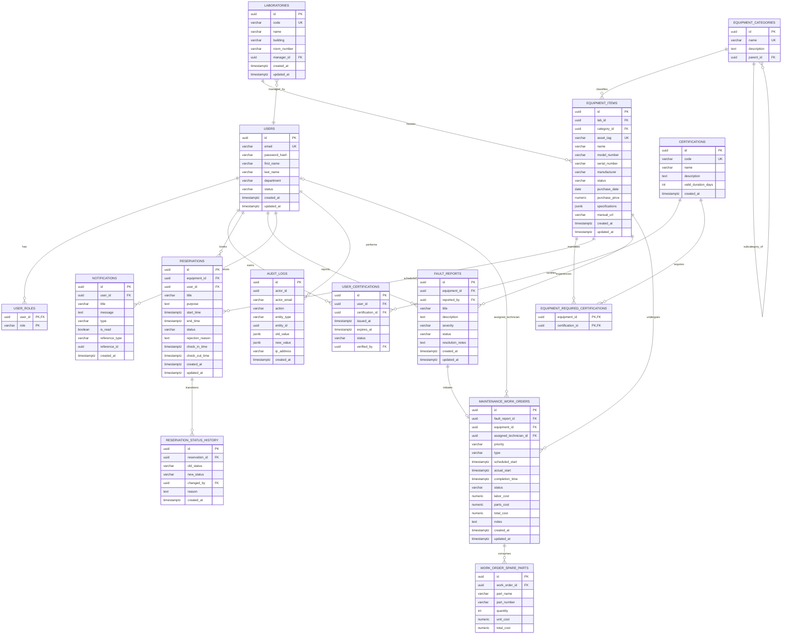

# LabLedger Data Model & Database Architecture

## 1. Overview & Principles

The LabLedger persistence layer is built on **PostgreSQL 16+** and managed through **Flyway database migrations**. It reflects the high-reliability demands of an academic laboratory environment:
- **UUID Primary Keys**: Every primary entity uses `UUIDv4` identifiers to prevent ID enumeration and simplify cross-environment data seeding.
- **Strict Referential Integrity**: Foreign keys with restrictive or cascading constraints safeguard relational consistency.
- **UTC Timestamps**: All temporal columns use `TIMESTAMPTZ` and represent UTC timestamps.
- **Half-Open Reservation Intervals**: Temporal ranges are modeled as $[start\_time, end\_time)$ with application checks and native PostgreSQL range exclusion constraints.
- **Monetary Precision**: All monetary values (e.g., equipment purchase price, repair labor costs, spare parts) use `NUMERIC(12, 2)` mapped to Java `BigDecimal`.
- **Audit Immutability**: The `audit_logs` table is strictly append-only, capturing state transitions across key domains.

---

## 2. Entity-Relationship Diagram



---

## 3. Relational Schema Specifications

### 3.1 Authentication & User Management

#### `users`
Primary user table representing students, faculty, lab managers, and administrators.
```sql
CREATE TABLE users (
    id UUID PRIMARY KEY DEFAULT gen_random_uuid(),
    email VARCHAR(255) NOT NULL,
    password_hash VARCHAR(255) NOT NULL,
    first_name VARCHAR(100) NOT NULL,
    last_name VARCHAR(100) NOT NULL,
    department VARCHAR(150) NOT NULL,
    status VARCHAR(50) NOT NULL DEFAULT 'ACTIVE',
    created_at TIMESTAMPTZ NOT NULL DEFAULT CURRENT_TIMESTAMP,
    updated_at TIMESTAMPTZ NOT NULL DEFAULT CURRENT_TIMESTAMP,
    CONSTRAINT uk_users_email UNIQUE (email),
    CONSTRAINT chk_users_status CHECK (status IN ('ACTIVE', 'SUSPENDED', 'INACTIVE'))
);
CREATE INDEX idx_users_email ON users(email);
CREATE INDEX idx_users_status ON users(status);
```

#### `user_roles`
User role mappings implementing Role-Based Access Control (RBAC).
```sql
CREATE TABLE user_roles (
    user_id UUID NOT NULL,
    role VARCHAR(50) NOT NULL,
    PRIMARY KEY (user_id, role),
    CONSTRAINT fk_user_roles_user FOREIGN KEY (user_id) REFERENCES users(id) ON DELETE CASCADE,
    CONSTRAINT chk_user_roles_role CHECK (role IN ('ROLE_STUDENT', 'ROLE_FACULTY', 'ROLE_LAB_MANAGER', 'ROLE_ADMIN'))
);
```

#### `certifications` & `user_certifications`
Tracks safety and operational qualifications required to book high-risk equipment (e.g., CNC milling machines, NMR spectrometers, high-power lasers).
```sql
CREATE TABLE certifications (
    id UUID PRIMARY KEY DEFAULT gen_random_uuid(),
    code VARCHAR(50) NOT NULL,
    name VARCHAR(150) NOT NULL,
    description TEXT,
    valid_duration_days INT NOT NULL,
    created_at TIMESTAMPTZ NOT NULL DEFAULT CURRENT_TIMESTAMP,
    CONSTRAINT uk_certifications_code UNIQUE (code)
);

CREATE TABLE user_certifications (
    id UUID PRIMARY KEY DEFAULT gen_random_uuid(),
    user_id UUID NOT NULL,
    certification_id UUID NOT NULL,
    issued_at TIMESTAMPTZ NOT NULL,
    expires_at TIMESTAMPTZ NOT NULL,
    status VARCHAR(50) NOT NULL DEFAULT 'ACTIVE',
    verified_by UUID,
    CONSTRAINT fk_uc_user FOREIGN KEY (user_id) REFERENCES users(id) ON DELETE CASCADE,
    CONSTRAINT fk_uc_cert FOREIGN KEY (certification_id) REFERENCES certifications(id) ON DELETE RESTRICT,
    CONSTRAINT fk_uc_verifier FOREIGN KEY (verified_by) REFERENCES users(id) ON DELETE SET NULL,
    CONSTRAINT chk_uc_status CHECK (status IN ('ACTIVE', 'REVOKED', 'EXPIRED')),
    CONSTRAINT uk_user_active_cert UNIQUE (user_id, certification_id)
);
CREATE INDEX idx_uc_user_id ON user_certifications(user_id);
```

---

### 3.2 Equipment Inventory & Locations

#### `laboratories`
Physical facilities housing laboratory instruments.
```sql
CREATE TABLE laboratories (
    id UUID PRIMARY KEY DEFAULT gen_random_uuid(),
    code VARCHAR(50) NOT NULL,
    name VARCHAR(150) NOT NULL,
    building VARCHAR(100) NOT NULL,
    room_number VARCHAR(50) NOT NULL,
    manager_id UUID,
    created_at TIMESTAMPTZ NOT NULL DEFAULT CURRENT_TIMESTAMP,
    updated_at TIMESTAMPTZ NOT NULL DEFAULT CURRENT_TIMESTAMP,
    CONSTRAINT uk_labs_code UNIQUE (code),
    CONSTRAINT fk_labs_manager FOREIGN KEY (manager_id) REFERENCES users(id) ON DELETE SET NULL
);
CREATE INDEX idx_labs_manager ON laboratories(manager_id);
```

#### `equipment_categories`
Hierarchical classification of equipment (e.g., Analytical Instruments > Spectrometry > Mass Spec).
```sql
CREATE TABLE equipment_categories (
    id UUID PRIMARY KEY DEFAULT gen_random_uuid(),
    name VARCHAR(100) NOT NULL,
    description TEXT,
    parent_id UUID,
    CONSTRAINT uk_equipment_categories_name UNIQUE (name),
    CONSTRAINT fk_eq_cat_parent FOREIGN KEY (parent_id) REFERENCES equipment_categories(id) ON DELETE RESTRICT
);
```

#### `equipment_items`
Physical hardware assets managed in the platform.
```sql
CREATE TABLE equipment_items (
    id UUID PRIMARY KEY DEFAULT gen_random_uuid(),
    lab_id UUID NOT NULL,
    category_id UUID NOT NULL,
    asset_tag VARCHAR(100) NOT NULL,
    name VARCHAR(200) NOT NULL,
    model_number VARCHAR(100),
    serial_number VARCHAR(100),
    manufacturer VARCHAR(100),
    status VARCHAR(50) NOT NULL DEFAULT 'AVAILABLE',
    purchase_date DATE,
    purchase_price NUMERIC(12, 2),
    specifications JSONB,
    manual_url VARCHAR(500),
    created_at TIMESTAMPTZ NOT NULL DEFAULT CURRENT_TIMESTAMP,
    updated_at TIMESTAMPTZ NOT NULL DEFAULT CURRENT_TIMESTAMP,
    CONSTRAINT uk_equipment_asset_tag UNIQUE (asset_tag),
    CONSTRAINT fk_equipment_lab FOREIGN KEY (lab_id) REFERENCES laboratories(id) ON DELETE RESTRICT,
    CONSTRAINT fk_equipment_category FOREIGN KEY (category_id) REFERENCES equipment_categories(id) ON DELETE RESTRICT,
    CONSTRAINT chk_equipment_status CHECK (status IN ('AVAILABLE', 'IN_USE', 'UNDER_MAINTENANCE', 'DECOMMISSIONED'))
);
CREATE INDEX idx_equipment_lab_id ON equipment_items(lab_id);
CREATE INDEX idx_equipment_category_id ON equipment_items(category_id);
CREATE INDEX idx_equipment_status ON equipment_items(status);
```

#### `equipment_required_certifications`
Associates equipment items with prerequisite user certifications.
```sql
CREATE TABLE equipment_required_certifications (
    equipment_id UUID NOT NULL,
    certification_id UUID NOT NULL,
    PRIMARY KEY (equipment_id, certification_id),
    CONSTRAINT fk_erc_equipment FOREIGN KEY (equipment_id) REFERENCES equipment_items(id) ON DELETE CASCADE,
    CONSTRAINT fk_erc_cert FOREIGN KEY (certification_id) REFERENCES certifications(id) ON DELETE CASCADE
);
```

---

### 3.3 Reservations & Scheduling

#### `reservations`
Bookings made by university members for equipment usage.
```sql
CREATE TABLE reservations (
    id UUID PRIMARY KEY DEFAULT gen_random_uuid(),
    equipment_id UUID NOT NULL,
    user_id UUID NOT NULL,
    title VARCHAR(150) NOT NULL,
    purpose TEXT NOT NULL,
    start_time TIMESTAMPTZ NOT NULL,
    end_time TIMESTAMPTZ NOT NULL,
    status VARCHAR(50) NOT NULL DEFAULT 'PENDING',
    rejection_reason TEXT,
    check_in_time TIMESTAMPTZ,
    check_out_time TIMESTAMPTZ,
    created_at TIMESTAMPTZ NOT NULL DEFAULT CURRENT_TIMESTAMP,
    updated_at TIMESTAMPTZ NOT NULL DEFAULT CURRENT_TIMESTAMP,
    CONSTRAINT fk_res_equipment FOREIGN KEY (equipment_id) REFERENCES equipment_items(id) ON DELETE RESTRICT,
    CONSTRAINT fk_res_user FOREIGN KEY (user_id) REFERENCES users(id) ON DELETE RESTRICT,
    CONSTRAINT chk_res_interval CHECK (start_time < end_time),
    CONSTRAINT chk_res_status CHECK (status IN ('PENDING', 'CONFIRMED', 'REJECTED', 'CHECKED_IN', 'COMPLETED', 'CANCELLED', 'NO_SHOW'))
);

CREATE INDEX idx_res_equipment_time ON reservations(equipment_id, start_time, end_time);
CREATE INDEX idx_res_user_id ON reservations(user_id);
CREATE INDEX idx_res_status ON reservations(status);
```

#### Exclusion Constraint (Conflict Prevention Engine)
```sql
CREATE EXTENSION IF NOT EXISTS btree_gist;

ALTER TABLE reservations
ADD CONSTRAINT uk_res_equipment_interval_no_overlap
EXCLUDE USING gist (
    equipment_id WITH =,
    tstzrange(start_time, end_time, '[)') WITH &&
)
WHERE (status IN ('CONFIRMED', 'CHECKED_IN', 'PENDING'));
```
> **Explanation**:
> The exclusion constraint ensures that for any two rows with the same `equipment_id`, the half-open temporal range `tstzrange(start_time, end_time, '[)')` cannot overlap (`&&`) if both are in `CONFIRMED`, `CHECKED_IN`, or `PENDING` status. Cancelled, completed, or rejected bookings release their time slots automatically.

#### `reservation_status_history`
Lifecycle event tracking for reservations.
```sql
CREATE TABLE reservation_status_history (
    id UUID PRIMARY KEY DEFAULT gen_random_uuid(),
    reservation_id UUID NOT NULL,
    old_status VARCHAR(50),
    new_status VARCHAR(50) NOT NULL,
    changed_by UUID NOT NULL,
    reason TEXT,
    created_at TIMESTAMPTZ NOT NULL DEFAULT CURRENT_TIMESTAMP,
    CONSTRAINT fk_rsh_reservation FOREIGN KEY (reservation_id) REFERENCES reservations(id) ON DELETE CASCADE,
    CONSTRAINT fk_rsh_user FOREIGN KEY (changed_by) REFERENCES users(id) ON DELETE RESTRICT
);
CREATE INDEX idx_rsh_res_id ON reservation_status_history(reservation_id);
```

---

### 3.4 Fault Reports & Maintenance Work Orders

#### `fault_reports`
User or technician submissions documenting malfunctioning equipment.
```sql
CREATE TABLE fault_reports (
    id UUID PRIMARY KEY DEFAULT gen_random_uuid(),
    equipment_id UUID NOT NULL,
    reported_by UUID NOT NULL,
    title VARCHAR(200) NOT NULL,
    description TEXT NOT NULL,
    severity VARCHAR(50) NOT NULL DEFAULT 'MEDIUM',
    status VARCHAR(50) NOT NULL DEFAULT 'REPORTED',
    resolution_notes TEXT,
    created_at TIMESTAMPTZ NOT NULL DEFAULT CURRENT_TIMESTAMP,
    updated_at TIMESTAMPTZ NOT NULL DEFAULT CURRENT_TIMESTAMP,
    CONSTRAINT fk_fault_equipment FOREIGN KEY (equipment_id) REFERENCES equipment_items(id) ON DELETE RESTRICT,
    CONSTRAINT fk_fault_reporter FOREIGN KEY (reported_by) REFERENCES users(id) ON DELETE RESTRICT,
    CONSTRAINT chk_fault_severity CHECK (severity IN ('LOW', 'MEDIUM', 'HIGH', 'CRITICAL')),
    CONSTRAINT chk_fault_status CHECK (status IN ('REPORTED', 'TRIAGED', 'IN_WORK_ORDER', 'RESOLVED', 'DISMISSED'))
);
CREATE INDEX idx_fault_equipment ON fault_reports(equipment_id);
CREATE INDEX idx_fault_status ON fault_reports(status);
```

#### `maintenance_work_orders`
Scheduled or reactive maintenance tasks executed by technicians or vendors.
```sql
CREATE TABLE maintenance_work_orders (
    id UUID PRIMARY KEY DEFAULT gen_random_uuid(),
    fault_report_id UUID,
    equipment_id UUID NOT NULL,
    assigned_technician_id UUID,
    priority VARCHAR(50) NOT NULL DEFAULT 'MEDIUM',
    type VARCHAR(50) NOT NULL DEFAULT 'REACTIVE',
    scheduled_start TIMESTAMPTZ,
    actual_start TIMESTAMPTZ,
    completion_time TIMESTAMPTZ,
    status VARCHAR(50) NOT NULL DEFAULT 'OPEN',
    labor_cost NUMERIC(12, 2) DEFAULT 0.00,
    parts_cost NUMERIC(12, 2) DEFAULT 0.00,
    total_cost NUMERIC(12, 2) GENERATED ALWAYS AS (labor_cost + parts_cost) STORED,
    notes TEXT,
    created_at TIMESTAMPTZ NOT NULL DEFAULT CURRENT_TIMESTAMP,
    updated_at TIMESTAMPTZ NOT NULL DEFAULT CURRENT_TIMESTAMP,
    CONSTRAINT fk_wo_fault FOREIGN KEY (fault_report_id) REFERENCES fault_reports(id) ON DELETE SET NULL,
    CONSTRAINT fk_wo_equipment FOREIGN KEY (equipment_id) REFERENCES equipment_items(id) ON DELETE RESTRICT,
    CONSTRAINT fk_wo_technician FOREIGN KEY (assigned_technician_id) REFERENCES users(id) ON DELETE SET NULL,
    CONSTRAINT chk_wo_priority CHECK (priority IN ('LOW', 'MEDIUM', 'HIGH', 'URGENT')),
    CONSTRAINT chk_wo_type CHECK (type IN ('PREVENTIVE', 'REACTIVE', 'CALIBRATION', 'INSPECTION')),
    CONSTRAINT chk_wo_status CHECK (status IN ('OPEN', 'ASSIGNED', 'IN_PROGRESS', 'WAITING_FOR_PARTS', 'COMPLETED', 'CANCELLED'))
);
CREATE INDEX idx_wo_equipment ON maintenance_work_orders(equipment_id);
CREATE INDEX idx_wo_status ON maintenance_work_orders(status);
CREATE INDEX idx_wo_technician ON maintenance_work_orders(assigned_technician_id);
```

#### `work_order_spare_parts`
Tracks individual parts replaced during maintenance for inventory depletion and cost accounting.
```sql
CREATE TABLE work_order_spare_parts (
    id UUID PRIMARY KEY DEFAULT gen_random_uuid(),
    work_order_id UUID NOT NULL,
    part_name VARCHAR(150) NOT NULL,
    part_number VARCHAR(100),
    quantity INT NOT NULL DEFAULT 1,
    unit_cost NUMERIC(12, 2) NOT NULL DEFAULT 0.00,
    total_cost NUMERIC(12, 2) GENERATED ALWAYS AS (quantity * unit_cost) STORED,
    CONSTRAINT fk_wosp_work_order FOREIGN KEY (work_order_id) REFERENCES maintenance_work_orders(id) ON DELETE CASCADE,
    CONSTRAINT chk_wosp_qty CHECK (quantity > 0)
);
CREATE INDEX idx_wosp_wo_id ON work_order_spare_parts(work_order_id);
```

---

### 3.5 Notifications & Auditing

#### `notifications`
In-app alerts for reservation confirmations, approval requests, fault triage, and maintenance notices.
```sql
CREATE TABLE notifications (
    id UUID PRIMARY KEY DEFAULT gen_random_uuid(),
    user_id UUID NOT NULL,
    title VARCHAR(150) NOT NULL,
    message TEXT NOT NULL,
    type VARCHAR(50) NOT NULL,
    is_read BOOLEAN NOT NULL DEFAULT FALSE,
    reference_type VARCHAR(50),
    reference_id UUID,
    created_at TIMESTAMPTZ NOT NULL DEFAULT CURRENT_TIMESTAMP,
    CONSTRAINT fk_notif_user FOREIGN KEY (user_id) REFERENCES users(id) ON DELETE CASCADE,
    CONSTRAINT chk_notif_type CHECK (type IN ('INFO', 'SUCCESS', 'WARNING', 'ALERT'))
);
CREATE INDEX idx_notif_user_unread ON notifications(user_id, is_read);
```

#### `audit_logs`
Immutable compliance and security log recording every sensitive data modification.
```sql
CREATE TABLE audit_logs (
    id UUID PRIMARY KEY DEFAULT gen_random_uuid(),
    actor_id UUID,
    actor_email VARCHAR(255),
    action VARCHAR(100) NOT NULL,
    entity_type VARCHAR(100) NOT NULL,
    entity_id UUID NOT NULL,
    old_value JSONB,
    new_value JSONB,
    ip_address VARCHAR(45),
    created_at TIMESTAMPTZ NOT NULL DEFAULT CURRENT_TIMESTAMP
);
CREATE INDEX idx_audit_entity ON audit_logs(entity_type, entity_id);
CREATE INDEX idx_audit_created ON audit_logs(created_at);
CREATE INDEX idx_audit_actor ON audit_logs(actor_id);
```

---

## 4. Flyway Migration Versioning Roadmap

Database evolutions are strictly managed through sequential Flyway scripts under `src/main/resources/db/migration/`:

| Version | Migration Script | Scope / Summary |
|---|---|---|
| `V1__init_extensions_and_users.sql` | Enable `uuid-ossp` and `btree_gist`; create `users`, `user_roles`, `certifications`, `user_certifications`. |
| `V2__init_inventory_and_laboratories.sql` | Create `laboratories`, `equipment_categories`, `equipment_items`, `equipment_required_certifications`. |
| `V3__init_reservations_and_exclusion_constraint.sql` | Create `reservations`, `reservation_status_history`, and the GiST exclusion constraint for conflict-free scheduling. |
| `V4__init_maintenance_and_faults.sql` | Create `fault_reports`, `maintenance_work_orders`, `work_order_spare_parts`. |
| `V5__init_notifications_and_audit.sql` | Create `notifications` and `audit_logs` tables. |
| `V6__seed_initial_reference_data.sql` | Seed initial roles, categories, sample laboratories, and system administrator account. |

> **Production Rule**: Hibernate schema auto-generation is forbidden in production (`spring.jpa.hibernate.ddl-auto: validate`). Flyway executes migrations automatically at startup, ensuring schema reproducibility.
