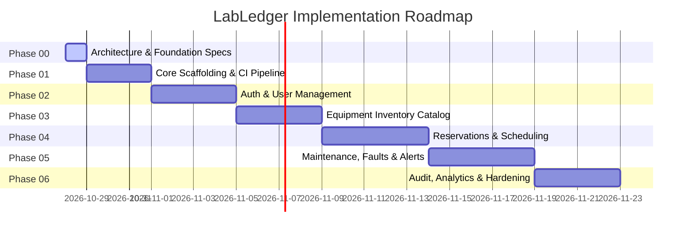

# LabLedger Implementation Plan & Engineering Roadmap

## 1. Project Overview & Delivery Principles

LabLedger is engineered iteratively in **7 structured phases (Phase 00 to Phase 06)**. Each phase represents a self-contained, verifiable increment of architectural scaffolding, backend services, frontend UI, automated tests, and deployment readiness.

### Key Implementation Principles
- **No Mock / Fake Backends**: Frontends interact with real Spring Boot REST endpoints backed by PostgreSQL. No dummy button handlers or client-only mock states.
- **Strict Layering**: No controller may execute domain logic. All operations pass through `Controller -> Service -> Repository -> Entity` with immutable DTO boundaries.
- **Schema Migrations Only**: Every database change is delivered as an immutable Flyway migration script. Hibernate schema auto-generation is disabled (`validate` mode).
- **Test-First or Test-Accompanied**: Every service method, endpoint, and UI flow is accompanied by unit, slice, or integration tests before being marked complete.
- **Verified Deliverables**: Each phase concludes with automated verification, git commit, and milestone reporting.

---

## 2. Phase-by-Phase Roadmap

---

### Phase 00: Project Foundation (Current Phase)
**Goal**: Establish comprehensive architectural blueprints, database schema design, security model, testing strategy, ADRs, code style definitions, and clean Git baseline.

- [x] Inspect workspace, Git status, and remote repository state.
- [x] Author `docs/ARCHITECTURE.md` (Modular monolith, package design, concurrency, time handling).
- [x] Author `docs/DATA_MODEL.md` (Relational schema, exclusion constraints, ER diagram, Flyway plan).
- [x] Author `docs/SECURITY.md` (Server-side sessions, CSRF, RBAC, password policy).
- [x] Author `docs/TESTING_STRATEGY.md` (Test pyramid, Testcontainers, Vitest, RTL, CI integration).
- [x] Author `docs/DECISIONS.md` (ADR-001 through ADR-007).
- [x] Author root `.editorconfig`, `.gitignore`, and `.env.example`.
- [x] Author root `README.md` and persistent `AGENTS.md`.
- [x] Commit baseline foundation and push branch to origin.

---

### Phase 01: Visual Identity and Landing Page
**Goal**: Build the visual foundation and a polished, responsive public landing page for LabLedger with light and dark themes.

- [x] Design distinctive LabLedger logo mark and wordmark.
- [x] Public navigation with branding, links, and Theme switcher.
- [x] High-quality hero section with tagline and primary call to action.
- [x] Authentic product preview showcasing instrument status and laboratory console.
- [x] Feature highlights covering equipment, reservations, maintenance, and auditability.
- [x] Interactive fault-to-maintenance lifecycle workflow diagram.
- [x] Restrained footer, responsive layouts, accessibility, and Vitest suite.

---

### Phase 02: Spring Boot Foundation and Database Integration
**Goal**: Establish runnable backend with Spring Boot 3.5.x on Java 21, PostgreSQL database, Flyway migrations, and error contracts.

- [x] Maven-based Spring Boot foundation with modular package layout.
- [x] Flyway `V1__init_schema.sql` (users, user_roles, laboratories).
- [x] RFC 7807 `ProblemDetail` GlobalExceptionHandler for 400, 404, 409, 422, 500.
- [x] System status and database connectivity endpoint (`/api/v1/system/status`).
- [x] Centralized frontend API client with environment-aware baseURL and ProblemDetail parsing.
- [x] Automated tests for backend and frontend.

---

### Phase 03: Authentication and Role-Based Authorization
**Goal**: Implement complete authentication and authorization using Spring Security stateful sessions, CSRF protection, and role guards.

- [x] Flyway migration `V2__auth_roles_and_security_enhancements.sql` (roles check constraint, brute-force throttling fields).
- [x] Roles: `ROLE_ADMIN`, `ROLE_LAB_ASSISTANT`, `ROLE_TECHNICIAN`, `ROLE_STUDENT`, `ROLE_FACULTY`.
- [x] Server-side session authentication (`JSESSIONID`, `HttpOnly`, `SameSite=STRICT`).
- [x] Strict SPA CSRF protection with `CookieCsrfTokenRepository` (`XSRF-TOKEN` cookie, `X-XSRF-TOKEN` header validation).
- [x] Password hashing with `BCryptPasswordEncoder(12)`.
- [x] Brute-force throttling: 5 consecutive failed attempts lock account for 15 minutes (`AccountLockedException`, 423 Locked).
- [x] Account status enforcement (`ACTIVE`, `SUSPENDED`, `INACTIVE`) blocking logins (`AccountDisabledException`, 403 Forbidden).
- [x] Endpoints: `POST /api/v1/auth/login`, `POST /api/v1/auth/logout`, `GET /api/v1/auth/me`, `GET /api/v1/auth/csrf`, `PATCH /api/v1/users/{id}/status`.
- [x] Configurable administrator bootstrap runner via environment variables (`INITIAL_ADMIN_EMAIL`, `INITIAL_ADMIN_PASSWORD`).
- [x] Frontend `AuthContext`, `useAuth` hook, and session restoration on mount.
- [x] `ProtectedRoute` with optional role authorization check.
- [x] Polished `LoginPage`, `ProfilePage`, `ForbiddenPage` (403), and role-aware `Navbar`.
- [x] Comprehensive backend tests (18 passed) and frontend tests (22 passed).

---

### Phase 04: Equipment Inventory & Laboratory Module
**Goal**: Implement laboratory management, hierarchical equipment categories, physical instrument tracking, and operational status transitions.

**Deliverables**:
- **Backend**:
  - Flyway migration `V2__init_inventory_and_laboratories.sql`.
  - Entities: `Laboratory`, `EquipmentCategory`, `EquipmentItem`.
  - DTOs: `EquipmentSummaryResponse`, `EquipmentDetailResponse`, `CreateEquipmentRequest`, `UpdateEquipmentRequest`.
  - Service: `EquipmentService`, `LaboratoryService` with status lifecycle checks (`AVAILABLE`, `IN_USE`, `UNDER_MAINTENANCE`, `DECOMMISSIONED`).
  - Controller: `EquipmentController`, `LaboratoryController` with pagination, filtering by lab/category/status, and search.
- **Frontend**:
  - Equipment catalog view with search bar, category filters, and status badges.
  - Equipment detail page showing specifications, required certifications, and operation manuals.
  - Lab Manager equipment creation and editing modal.
- **Testing**:
  - Unit tests for status transition business rules.
  - `@WebMvcTest` controller slice tests with pagination checks.
  - Repository tests for custom filtering queries with Testcontainers.
  - Frontend component tests for catalog rendering and filter interactions.

---

### Phase 04: Reservations & Scheduling Engine
**Goal**: Deliver conflict-free equipment reservation workflows, calendar views, approval mechanisms, and half-open interval validation.

**Deliverables**:
- **Backend**:
  - Flyway migration `V3__init_reservations_and_exclusion_constraint.sql` with GiST range exclusion.
  - Entities: `Reservation`, `ReservationStatusHistory`.
  - DTOs: `ReservationRequest`, `ReservationResponse`, `ApprovalRequest`, `CalendarSlotResponse`.
  - Custom Validator: `@ValidTimeInterval` ensuring $[start, end)$ integrity and minimum/maximum booking constraints.
  - Service: `ReservationService` using pessimistic row locking, conflict verification, prerequisite certification checks, and check-in/out transitions.
  - Controller: `ReservationController` (`POST /reservations`, `PATCH /reservations/{id}/approval`, `POST /reservations/{id}/check-in`).
- **Frontend**:
  - Interactive calendar/schedule view displaying occupied and available slots.
  - Booking modal with interval picker and prerequisite certification check warning.
  - "My Reservations" tab with check-in, check-out, and cancellation controls.
  - Lab Manager pending reservations review dashboard.
- **Testing**:
  - Concurrency stress tests with multi-threaded attempts on the same time slot (verifying exclusion constraint and 409 Conflict).
  - Validation tests for past dates, inverted intervals, and missing certifications.
  - Full end-to-end integration tests using Testcontainers.

---

### Phase 05: Fault Reporting, Maintenance Work Orders & Notifications
**Goal**: Build fault reporting by lab operators, triage and work order lifecycle, spare parts consumption, and asynchronous notifications.

**Deliverables**:
- **Backend**:
  - Flyway migration `V4__init_maintenance_and_faults.sql` and `V5__init_notifications_and_audit.sql`.
  - Entities: `FaultReport`, `MaintenanceWorkOrder`, `WorkOrderSparePart`, `Notification`.
  - DTOs: `FaultReportRequest`, `WorkOrderCreateRequest`, `WorkOrderResponse`, `SparePartDto`.
  - Event Listeners: `NotificationEventListener` responding to `ReservationConfirmedEvent`, `WorkOrderCreatedEvent`, etc.
  - Service: `FaultService`, `WorkOrderService` (auto-transitioning equipment to `UNDER_MAINTENANCE`), `NotificationService`.
  - Controller: `FaultReportController`, `WorkOrderController`, `NotificationController`.
- **Frontend**:
  - "Report an Issue" modal with severity selector and equipment tag autocomplete.
  - Maintenance dashboard with Kanban/table view of work orders (Open, In Progress, Waiting Parts, Completed).
  - In-app notification bell with real-time unread count and popover list.
- **Testing**:
  - Service tests verifying that initiating a work order marks equipment unavailable for booking.
  - Financial calculations test for spare parts and labor using `BigDecimal`.
  - Asynchronous event delivery integration test.

---

### Phase 06: Audit Logging, Analytics, Reporting & Production Hardening
**Goal**: Integrate append-only audit tracking, utilization analytics, MTBF/MTTR metrics, CSV report exports, and comprehensive end-to-end validation.

**Deliverables**:
- **Backend**:
  - Entities: `AuditLog`.
  - Spring AOP or Hibernate Envers/EntityListeners logging state changes with actor ID and IP address.
  - Service: `AnalyticsService` calculating equipment utilization percentage, peak usage times, MTBF (Mean Time Between Failures), and MTTR (Mean Time To Repair).
  - Reporting Controller: `AnalyticsController` with CSV export streaming.
  - Actuator metrics, health checks, and OpenAPI/Swagger documentation refinement.
- **Frontend**:
  - Analytics dashboard with charts (utilization rates, downtime by lab, maintenance costs).
  - Audit log table with filterable entity and date range views.
  - CSV report download buttons.
- **Hardening & Verification**:
  - End-to-end integration test suite execution with Testcontainers.
  - Security audit verifying role protection, CSRF enforcement, and SQL injection resistance.
  - Production Dockerfile multi-stage build optimization.

---

## 3. Dependency & Risk Analysis

| Risk / Challenge | Severity | Mitigation Strategy |
|---|:---:|---|
| **Concurrent double-booking race condition** | High | PostgreSQL `btree_gist` exclusion constraint prevents overlaps at the storage engine level; pessimistic locking at the service layer prevents transaction contention. |
| **Session cookie dropping on cross-origin local dev** | Medium | In development, Vite dev server proxies `/api` calls directly to `http://localhost:8080`, preserving same-origin cookie semantics without complex CORS setups. |
| **Complex timezone discrepancies** | High | All database columns are strictly `TIMESTAMPTZ` (UTC). Backend enforces UTC everywhere. Conversion to browser timezone happens exclusively in React display components. |
| **Entity state leakage in REST APIs** | Medium | Zero entities exposed. Layered architecture mandates Java 21 `record` DTOs and explicit mappers for all request and response payloads. |
| **Database migration drift** | High | Flyway runs on application bootstrap. Hibernate schema update is strictly forbidden (`ddl-auto: validate`). CI tests execute migrations against clean PostgreSQL Testcontainers. |
